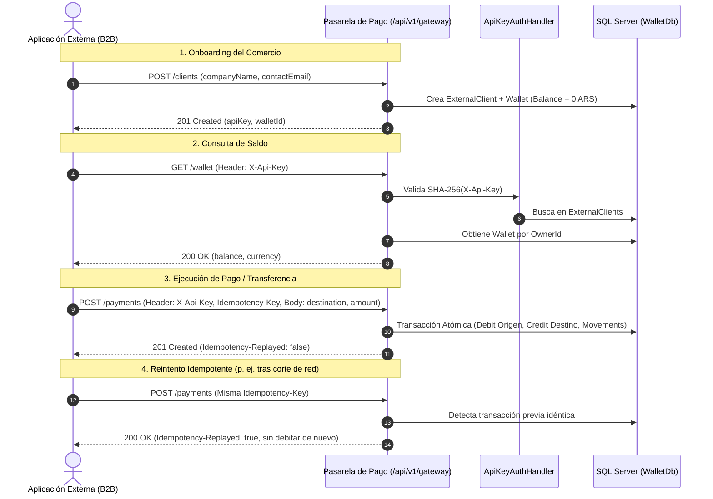

# Pasarela de Pago B2B (Wallet as a Service) — Documentación de Arquitectura e Integración (Metodología IDEAL)

Este documento condensa la guía de integración de extremo a extremo y la fundamentación arquitectónica/técnica utilizada para implementar la pasarela de pagos B2B que permite a aplicaciones y APIs externas consumir nuestra pasarela financiera bajo el enfoque **Domain-Driven Design (DDD)**.

La estructura sigue el framework **IDEAL**:
* **I - Intención:** Objetivos de negocio, propósito y visión del cambio de rumbo hacia B2B WaaS.
* **D - Descripción:** Arquitectura del sistema, modelo de dominio DDD, persistencia polimórfica y autenticación.
* **E - Ejemplo:** Flujo completo de integración extremo a extremo con comandos cURL, PowerShell y payloads reales.
* **A - Acción:** Detalle técnico paso a paso de las implementaciones, migraciones y código desarrollado.
* **L - Límites:** Invariantes de dominio, límites monetarios, reglas de idempotencia, seguridad y restricciones arquitectónicas.

---

## I — Intención (Intention)

### 1. Contexto y Propósito
El sistema original fue concebido como una billetera monousuario vinculada directamente a personas físicas (`UserId`). La redirección estratégica (**REDIRECCIÓN TFI**) orientó el producto hacia un modelo **B2B (Wallet as a Service - WaaS)** donde:
1. Nuestra plataforma actúa como una **pasarela de pagos propia**.
2. APIs y aplicaciones de comercios externos pueden integrarse para cobrar, transferir fondos, gestionar su saldo en ARS y conciliar operaciones contables en tiempo real sin intermediarios externos.
3. Se desacopla la titularidad de la billetera: una billetera ya no pertenece obligatoriamente a un `UserId`, sino a un titular genérico abstracto (`WalletOwner`), permitiendo que tanto usuarios particulares (`User`) como clientes empresariales/APIs externas (`ExternalClient`) sean titulares de primer orden.

### 2. Objetivos de Negocio y Técnicos
* **Autonomía Operativa:** Proveer endpoints REST de alta confiabilidad para operaciones de cobro y pago entre billeteras.
* **Seguridad B2B:** Identificación mediante `X-Api-Key` con almacenamiento seguro mediante hashing unidireccional (SHA-256).
* **Consistencia e Idempotencia:** Garantía estricta contra cobros duplicados en caso de cortes de red o reintentos del comercio mediante cabeceras `Idempotency-Key` y respuestas `Idempotency-Replayed`.
* **Auditoría Contable Inmutable (Ledger):** Cada centavo que entra o sale genera un registro histórico inmutable (`Movement`) con su saldo posterior exacto (`BalanceAfter`).

---

## D — Descripción (Description)

### 1. Arquitectura de Capas
El proyecto sigue una arquitectura limpia orientada al dominio (Clean Architecture / DDD Onion):

```
┌────────────────────────────────────────────────────────┐
│                      Wallet.Api                        │
│   (Controllers, Auth Handlers, Swagger/OpenAPI, Tools) │
└──────────────────────────┬─────────────────────────────┘
                           │
┌──────────────────────────▼─────────────────────────────┐
│                  Wallet.Application                    │
│   (Services: GatewayService, TransferService, etc.)   │
└──────────────────────────┬─────────────────────────────┘
                           │
┌──────────────────────────▼─────────────────────────────┐
│                    Wallet.Domain                       │
│ (Entities: WalletOwner, User, ExternalClient, Wallet,  │
│  Movement, Transfer; Value Objects: Money)             │
└──────────────────────────▲─────────────────────────────┘
                           │
┌──────────────────────────┴─────────────────────────────┐
│                 Wallet.Infrastructure                  │
│    (EF Core DbContext, TPT Mapping, SQL Repositories)   │
└────────────────────────────────────────────────────────┘
```

### 2. Jerarquía Polimórfica de Titularidad (Table-per-Type / TPT)
Para soportar titularidad polimórfica en persistencia relacional con EF Core y SQL Server, se adoptó la estrategia **TPT (Table-per-Type)**:
* `WalletOwners` (Tabla base):
  * `Id` (GUID - PK)
  * `IsActive` (BIT)
  * `CreatedAt` (DATETIMEOFFSET)
* `Users` (Tabla derivada):
  * `Id` (FK a `WalletOwners.Id`)
  * `FirstName`, `LastName`, `Email`, `NormalizedEmail`, `PasswordHash`, `SessionVersion`, `Role`.
* `ExternalClients` (Tabla derivada):
  * `Id` (FK a `WalletOwners.Id`)
  * `CompanyName`, `ContactEmail`, `Description`, `ApiKeyHash` (SHA-256).

### 3. Modelo de Dominio Rico (DDD)
* **`WalletOwner`:** Entidad base abstracta que defiende las invariantes de ciclo de vida del titular (`Deactivate()`).
* **`ExternalClient`:** Entidad B2B con constructor protegido y fábrica estática `Create()`, encapsulando la validación del hash de API Key y emails de contacto.
* **`Wallet` (Aggregate Root):** Apunta a un `OwnerId` (tipo `Guid`). Métodos transaccionales ricos: `Credit(Money)` y `Debit(Money)`. Defiende invariantes de sobregiro y descalce de divisas.
* **`Movement`:** Libro contable inmutable. No tiene setters públicos. Registra `Type` (Debit/Credit), `Amount`, `BalanceAfter`, `Source` (Transfer, DevelopmentFunding) y `SourceId`.
* **`Transfer`:** Maneja la transferencia entre dos billeteras (`SourceWalletId` y `DestinationWalletId`) con estado (`Pending`, `Completed`, `Failed`), clave de idempotencia (`IdempotencyKey`) y hash de contenido.
* **`Money` (Value Object):** Inmutable. Controla la moneda (`ARS`), prohíbe importes negativos y descarta fracciones más allá de 2 decimales (centavos).

### 4. Modelo de Autenticación Híbrido
* **B2C (Usuarios finales / Web):** `Bearer <JWT>` gestionado por `JwtBearerHandler` con validación de versión de sesión (`session_version`).
* **B2B (Clientes externos / APIs):** Esquema `"ApiKey"` gestionado por `ApiKeyAuthenticationHandler`. Lee la cabecera `X-Api-Key`, calcula su SHA-256 y autentica al `ExternalClient` con Claims de rol `ExternalClient`.

---

## E — Ejemplo (Example: Guía de Integración Extremo a Extremo)

Esta sección reproduce el flujo completo que un comercio o cliente externo realiza para operar con la pasarela.

### Requisitos Previos
* API corriendo en:
  * `https://localhost:7081` (HTTPS)
  * `http://localhost:5081` (HTTP)
* Swagger UI disponible en: `https://localhost:7081/swagger/index.html`



---

### Paso 1: Onboarding del Comercio (Registro B2B)
La aplicación cliente se registra por única vez en la pasarela.

* **Petición (PowerShell):**
  ```powershell
  $body = @{
      companyName = "Mi Tienda Online S.A."
      contactEmail = "pagos@mitienda.com"
      description = "Pasarela de cobro para compras web"
  } | ConvertTo-Json

  $comercio = Invoke-RestMethod -Uri "http://localhost:5081/api/v1/gateway/clients" `
      -Method Post -ContentType "application/json" -Body $body

  $comercio | ConvertTo-Json
  ```

* **Petición alternativa (cURL):**
  ```bash
  curl -X POST http://localhost:5081/api/v1/gateway/clients \
    -H "Content-Type: application/json" \
    -d '{"companyName":"Mi Tienda Online S.A.","contactEmail":"pagos@mitienda.com","description":"Pasarela de cobro para compras web"}'
  ```

* **Respuesta esperada (`201 Created`):**
  ```json
  {
    "id": "6b234a54-48c3-444f-9b32-4ea9934e45f3",
    "companyName": "Mi Tienda Online S.A.",
    "contactEmail": "pagos@mitienda.com",
    "description": "Pasarela de cobro para compras web",
    "apiKey": "7e0e1b08c75907c5c7996353ee699a928bcd1ec78c14778535c25381fb9b3d9b",
    "walletId": "61c28438-6930-41df-9e3b-ccf70d3680a9",
    "createdAt": "2026-10-31T03:20:04Z"
  }
  ```
  > [!IMPORTANT]
  > La `apiKey` en texto plano se entrega **únicamente** en esta respuesta. En base de datos solo se persiste su hash criptográfico SHA-256.

---

### Paso 2: Consulta de Saldo de la Billetera
El comercio utiliza su clave en la cabecera `X-Api-Key`.

* **Petición (PowerShell):**
  ```powershell
  $headers = @{ "X-Api-Key" = "7e0e1b08c75907c5c7996353ee699a928bcd1ec78c14778535c25381fb9b3d9b" }
  $billetera = Invoke-RestMethod -Uri "http://localhost:5081/api/v1/gateway/wallet" `
      -Method Get -Headers $headers
  $billetera | ConvertTo-Json
  ```

* **Respuesta esperada (`200 OK`):**
  ```json
  {
    "id": "61c28438-6930-41df-9e3b-ccf70d3680a9",
    "balance": 0.00,
    "currency": "ARS",
    "createdAt": "2026-10-31T03:20:04Z"
  }
  ```

---

### Paso 3: Acreditación de Fondos de Prueba (Development Funding)
En entornos locales/desarrollo, se inyectan fondos simulados auditables a través de la herramienta oficial:

* **Comando (PowerShell):**
  ```powershell
  $env:DOTNET_ENVIRONMENT = "Development"
  dotnet run --project Wallet.DevelopmentTools -- fund-wallet `
    --wallet-id 61c28438-6930-41df-9e3b-ccf70d3680a9 `
    --amount 10000.00 `
    --idempotency-key 11111111-1111-1111-1111-111111111111 `
    --server "(localdb)\MSSQLLocalDB" `
    --database "WalletDb" `
    --confirm-development-database
  ```

---

### Paso 4: Procesamiento de Pagos entre Billeteras
El comercio transfiere fondos hacia una cuenta de destino (por ejemplo, billetera de un proveedor o liquidación a un usuario).

* **Petición (PowerShell):**
  ```powershell
  $paymentBody = @{
      destinationWalletId = "c3b6b98e-f49c-41b8-868e-b002e65c8855"
      amount = 2500.50
  } | ConvertTo-Json

  $headers = @{
      "X-Api-Key" = "7e0e1b08c75907c5c7996353ee699a928bcd1ec78c14778535c25381fb9b3d9b"
      "Idempotency-Key" = [Guid]::NewGuid().ToString()
  }

  $pago = Invoke-RestMethod -Uri "http://localhost:5081/api/v1/gateway/payments" `
      -Method Post -ContentType "application/json" -Headers $headers -Body $paymentBody

  $pago | ConvertTo-Json
  ```

* **Respuesta esperada (`201 Created`):**
  ```http
  HTTP/1.1 201 Created
  Idempotency-Replayed: false
  Content-Type: application/json
  ```
  ```json
  {
    "id": "6b7186c2-5e69-4b03-a054-fdb5b03478a6",
    "sourceWalletId": "61c28438-6930-41df-9e3b-ccf70d3680a9",
    "destinationWalletId": "c3b6b98e-f49c-41b8-868e-b002e65c8855",
    "amount": 2500.50,
    "currency": "ARS",
    "status": "Completed",
    "createdAt": "2026-10-31T03:44:11Z"
  }
  ```

---

### Paso 5: Reintentos y Garantía de Idempotencia
Si la aplicación cliente sufre un timeout o interrupción de red y reintenta enviando **la misma** `Idempotency-Key`:

* **Respuesta esperada (`200 OK`):**
  ```http
  HTTP/1.1 200 OK
  Idempotency-Replayed: true
  Content-Type: application/json
  ```
  ```json
  {
    "id": "6b7186c2-5e69-4b03-a054-fdb5b03478a6",
    "sourceWalletId": "61c28438-6930-41df-9e3b-ccf70d3680a9",
    "destinationWalletId": "c3b6b98e-f49c-41b8-868e-b002e65c8855",
    "amount": 2500.50,
    "currency": "ARS",
    "status": "Completed",
    "createdAt": "2026-10-31T03:44:11Z"
  }
  ```
  *(El saldo permanece inalterado y no se descuenta dos veces).*

---

### Paso 6: Auditoría del Libro Mayor (Movements)
El comercio consulta sus movimientos contables:

* **Petición (PowerShell):**
  ```powershell
  $headers = @{ "X-Api-Key" = "7e0e1b08c75907c5c7996353ee699a928bcd1ec78c14778535c25381fb9b3d9b" }
  $movs = Invoke-RestMethod -Uri "http://localhost:5081/api/v1/gateway/movements" -Headers $headers
  $movs.items | ConvertTo-Json
  ```

* **Respuesta esperada (`200 OK`):**
  ```json
  [
    {
      "id": "58edeb9b-5838-484f-92ba-ddc9d4317ff1",
      "type": "Debit",
      "amount": 2500.50,
      "currency": "ARS",
      "balanceAfter": 7499.50,
      "source": "Transfer",
      "sourceId": "6b7186c2-5e69-4b03-a054-fdb5b03478a6",
      "createdAt": "2026-10-31T03:44:11Z"
    },
    {
      "id": "5fdbf41f-e7dd-4d96-850f-1cbccb440e87",
      "type": "Credit",
      "amount": 10000.00,
      "currency": "ARS",
      "balanceAfter": 10000.00,
      "source": "DevelopmentFunding",
      "sourceId": "27a91426-59cc-489a-a0f3-c9c714b404ab",
      "createdAt": "2026-10-31T03:40:43Z"
    }
  ]
  ```

---

## A — Acción (Action: Lógica y Pasos de Implementación)

A continuación se resume la secuencia metódica de ingeniería implementada para lograr esta funcionalidad:

### 1. Refactor del Dominio a DDD Puro (`Wallet.Domain`)
* **Jerarquía TPT:** Se creó la entidad abstracta `WalletOwner` (`Id`, `IsActive`, `CreatedAt`) y las entidades derivadas `User` y `ExternalClient`.
* **Desacople en `Wallet`:** Se cambió la propiedad rígida `UserId` por `OwnerId` (`Guid`), permitiendo que el agregado `Wallet` opere indistintamente con personas o sistemas B2B.
* **Inmutabilidad y Constructores:** Se eliminaron todos los setters públicos de las entidades, dejando constructores privados/protegidos para la materialización por reflexión de EF Core y métodos de fábrica estáticos (`Create(...)`) para instanciación controlada.

### 2. Infraestructura y Persistencia EF Core (`Wallet.Infrastructure`)
* **Configuración TPT:** En `WalletDbContext`, se mapeó `WalletOwner` a `[WalletOwners]`, `User` a `[Users]` y `ExternalClient` a `[ExternalClients]`.
* **Consultas Polimórficas Seguras:** Dado que EF Core no permite `FromSqlInterpolated` directo sobre jerarquías sin discriminador nativo, se implementó `db.Database.SqlQuery<bool>($"SELECT [IsActive] AS [Value] FROM [WalletOwners] WITH (HOLDLOCK) WHERE [Id] = {ownerId}")` para garantizar bloqueos de lectura consistentes durante transferencias.
* **Repositorio B2B:** Se implementó `IExternalClientRepository` y `SqlExternalClientRepository` con búsqueda indexada por `ApiKeyHash`.

### 3. Migración de Base de Datos con Preservación de Datos
* Se generó la migración `20261031025350_PolymorphicWalletOwner`.
* Se incluyeron sentencias SQL de inicialización de datos para que los usuarios existentes en `Users` migren automáticamente sus registros a la tabla base `WalletOwners` manteniendo integridad referencial.
* Se configuró `WalletDbContextFactory` implementando `IDesignTimeDbContextFactory<WalletDbContext>` para permitir migraciones en tiempo de diseño sin ambigüedades de inyección de dependencias.

### 4. Capa de Aplicación (`Wallet.Application`)
* **`GatewayService`:**
  * Generación de claves criptográficamente seguras (`RandomNumberGenerator` de 32 bytes en formato Hex).
  * Hashing unidireccional SHA-256 (`HashApiKey(apiKey)`).
  * Transaccionalidad de registro: creación atómica del `ExternalClient` y de su `Wallet` inicial en una misma unidad de trabajo.
* **`TransferService` & `WalletService`:**
  * Se adaptaron para operar contra `ICurrentUser.Id` como `OwnerId`, unificando la lógica de cobro/pago para usuarios web y clientes de API.

### 5. Seguridad y Autenticación en la API (`Wallet.Api`)
* **`ApiKeyAuthenticationHandler`:**
  * Esquema registrado: `"ApiKey"`.
  * Cabecera principal inspeccionada: `X-Api-Key` (con soporte alternativo para `Authorization: ApiKey <key>`).
  * Validación contra `IExternalClientRepository` verificando que el cliente exista y esté activo (`client.IsActive == true`).
  * Emisión de `ClaimsPrincipal` con rol `ExternalClient` e identificación del cliente.
* **Póliza de Autorización:** Se definió la póliza `"ExternalClient"` exigiendo rol y esquema `ApiKey`.

### 6. OpenAPI, Swagger UI y Experiencia de Desarrollo
* **`SecurityDocumentTransformer`:**
  * Registro del esquema OpenAPI `ApiKey` (`in: header`, `name: X-Api-Key`).
  * Marcado automático de requerimiento de seguridad en todos los endpoints `/api/v1/gateway/*`.
* **`GatewayController`:**
  * Exposición de parámetros de cabecera mediante `[FromHeader(Name = "X-Api-Key")]` para que Swagger UI dibuje campos interactivos en cada endpoint.
* **Herramientas de Idempotencia (`wallet-tools.js`):**
  * Auto-generación de `Idempotency-Key` en Swagger UI mediante un `MutationObserver` dinámico que inyecta un UUID fresco (`crypto.randomUUID()`) al abrir el endpoint.
  * Inyección del botón interactivo `[🔄 Generar nueva clave]` para renovar el código con un solo clic.
  * Fallback automático en el backend: si una llamada de API no incluye la cabecera `Idempotency-Key`, el controlador genera una automáticamente (`Guid.NewGuid().ToString("D")`), evitando errores 400 por omisión accidental.

---

## L — Límites (Limits & Invariants)

Para garantizar la estabilidad financiera y técnica del sistema, se establecieron los siguientes límites estrictos:

### 1. Límites Monetarios y de Negocio
* **Moneda Única:** Actualmente solo se admite `ARS`. Intentar operar con otra moneda genera excepción inmediata de descalce (`Currency mismatch`).
* **Precisión:** Estricta a 2 decimales (centavos). Toda fracción adicional es rechazada en la creación del Value Object `Money`.
* **Importe Mínimo:** `0,01 ARS` (no se admiten operaciones de cero o importes negativos).
* **Importe Máximo por Transferencia:** `780.400,00 ARS` (definido como cota superior por operación para control de riesgo).
* **Sobregiros:** Estrictamente prohibidos. Una billetera no puede tener saldo menor a `0,00 ARS`. Si `amount > Balance`, la operación se rechaza con `409 Conflict (INSUFFICIENT_FUNDS)`.

### 2. Límites de Idempotencia y Transaccionalidad
* **Ventana de Idempotencia:** La clave de idempotencia (`IdempotencyKey`) se persiste vinculada al hash SHA-256 de la petición (origen, destino, importe).
* **Conflicto de Idempotencia (`409 IDEMPOTENCY_CONFLICT`):** Si una clave se reutiliza con un importe o destino diferente al original, la transacción se aborta de inmediato.
* **Bloqueos de Concurrencia:** Las transferencias toman bloqueos consistentes sobre los registros de billetera involucrados (`RowVersion` / Concurrency Token y `HOLDLOCK` en SQL Server) para evitar condiciones de carrera o *double-spending*.

### 3. Límites de Seguridad y Acceso
* **Exposición de API Keys:** La clave solo se muestra una vez al momento de la creación. No existe endpoint de recuperación de clave en texto plano; si se extravía, debe generarse un nuevo cliente o rotarse la clave.
* **Revocación:** Cambiar `IsActive = false` en `WalletOwners` revoca de inmediato cualquier acceso tanto para tokens JWT como para solicitudes con API Key.
* **Rate Limiting:** El pipeline de ASP.NET Core impone limitador de tasa (`AddRateLimiter`) para prevenir ataques de fuerza bruta en autenticación y registro.

---

## Resumen de Endpoints de la Pasarela

| Método | Endpoint | Cabeceras Requeridas | Descripción |
|---|---|---|---|
| `POST` | `/api/v1/gateway/clients` | Ninguna (público) | Registro de nuevo cliente B2B y generación de API Key y Wallet. |
| `GET` | `/api/v1/gateway/wallet` | `X-Api-Key` | Consulta de saldo y estado de la billetera del cliente. |
| `POST` | `/api/v1/gateway/wallet` | `X-Api-Key` | Creación de billetera si el cliente aún no posee una. |
| `POST` | `/api/v1/gateway/payments` | `X-Api-Key`, `Idempotency-Key` (opcional con auto-gen) | Ejecución de pagos o transferencias hacia otra billetera. |
| `GET` | `/api/v1/gateway/movements` | `X-Api-Key` | Historial paginado de movimientos contables auditados (Ledger). |

---
*Documento generado para referencia de arquitectura, integración y traspaso entre agentes de desarrollo.*
